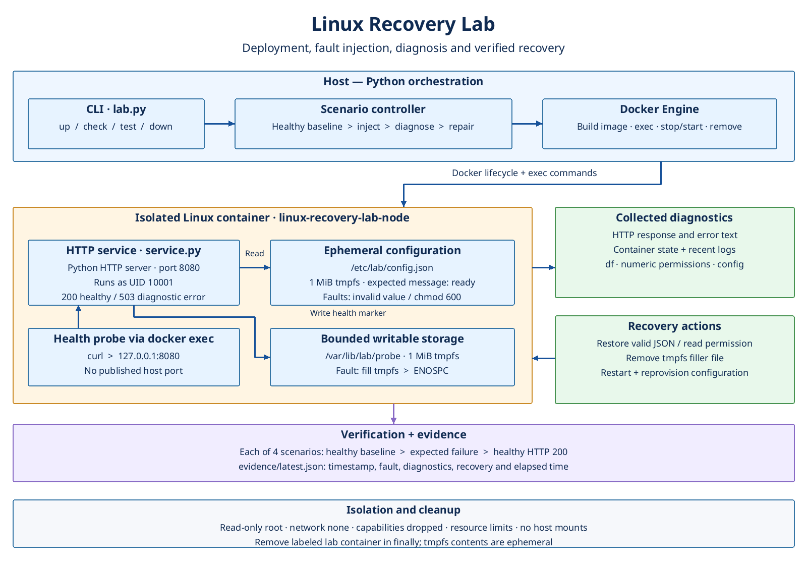

# Linux Recovery Lab

Deploy a small Linux HTTP service, inject operational faults, collect diagnostics, and verify recovery.

## Architecture



[Editable SVG](docs/architecture.svg)

## Run

Requires Python 3.10+ and a working Docker Engine. The first run downloads an Alpine-based Python image and builds a local image.

```sh
python3 lab.py test
```

Runs four scenarios and writes `evidence/latest.json`. Each scenario must start healthy, fail for the expected reason, and recover to HTTP 200. The container is removed afterward, including on scenario failure.

```sh
python3 lab.py up       # leave the service running for exploration
python3 lab.py check    # health response, logs, filesystem diagnostics
python3 lab.py down     # remove only the labeled lab container
```

## Faults

| Fault | Diagnosis | Recovery |
|---|---|---|
| Invalid configuration | HTTP 503 and configuration inspection | Restore valid JSON |
| Unreadable configuration | Permission error and numeric ownership/mode | Restore read permission |
| Full filesystem | ENOSPC and `df` | Remove bounded filler file |
| Stopped service | Container state and failed probe | Restart and reprovision ephemeral configuration |

The service runs as UID 10001 with a read-only root filesystem, no network access, and two 1 MiB tmpfs mounts. No host ports or host directories are mounted. Docker permissions are needed; administrative fault injection is scoped to this container.

This is a container-based operations lab, not physical hardware repair or a full VM/systemd installation exercise. See [incident guide](docs/incidents.md).
